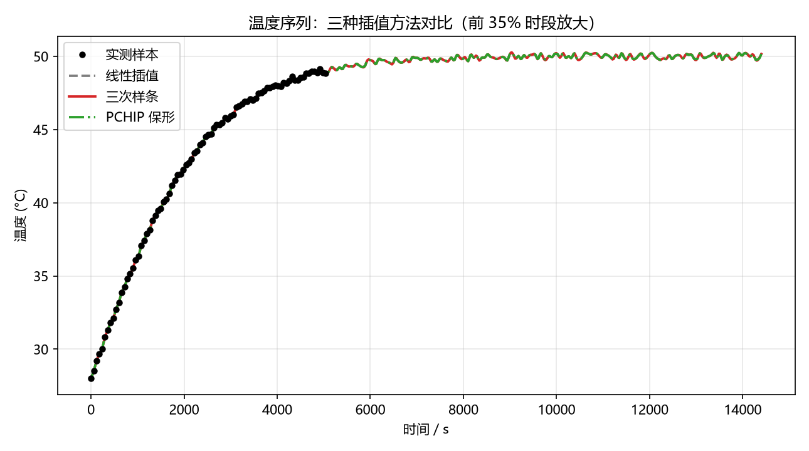
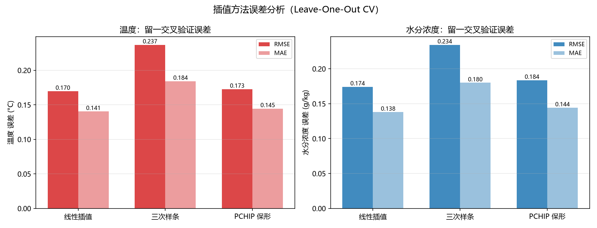
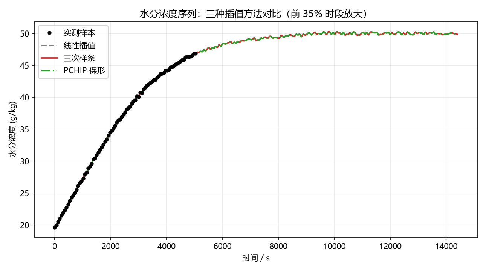
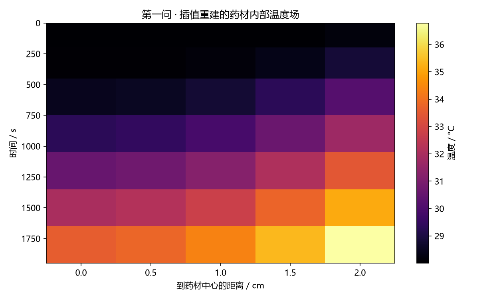
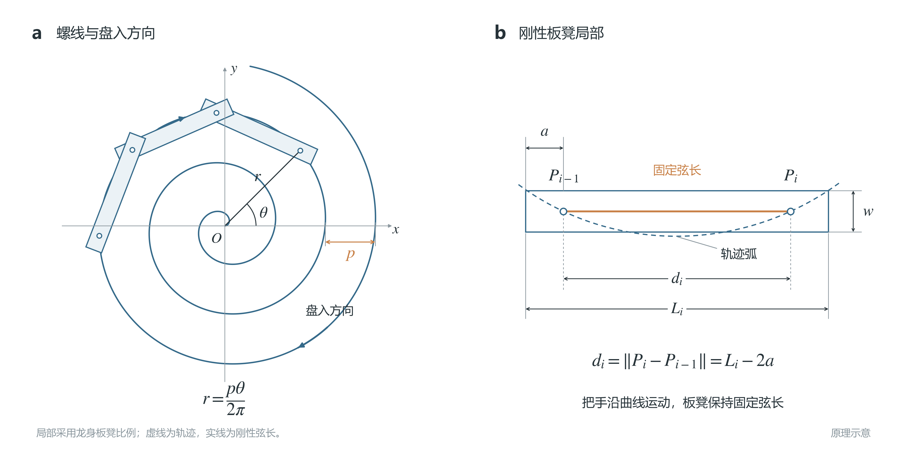
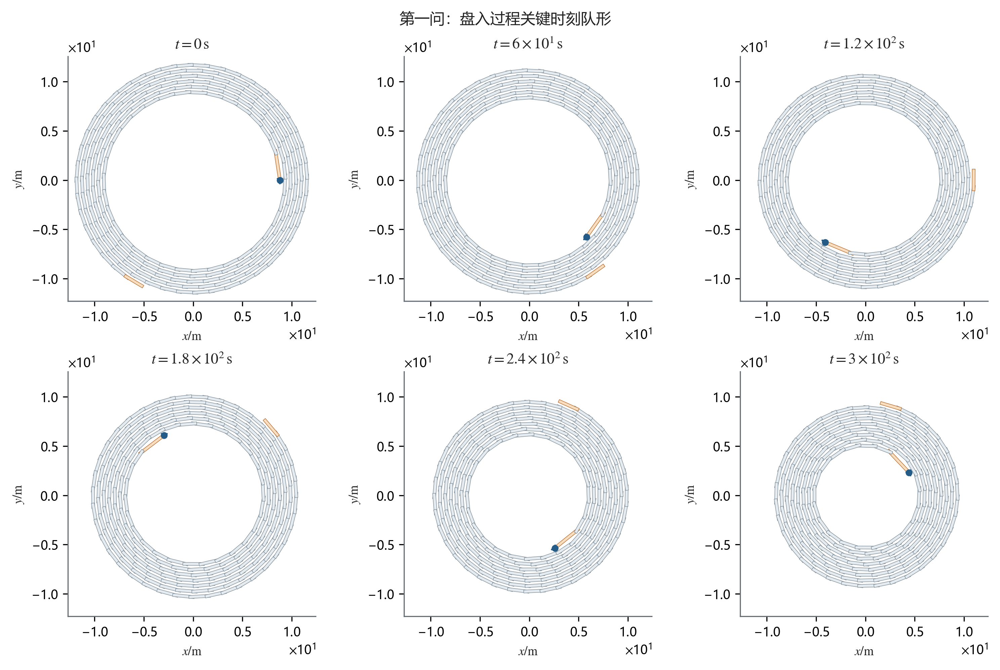
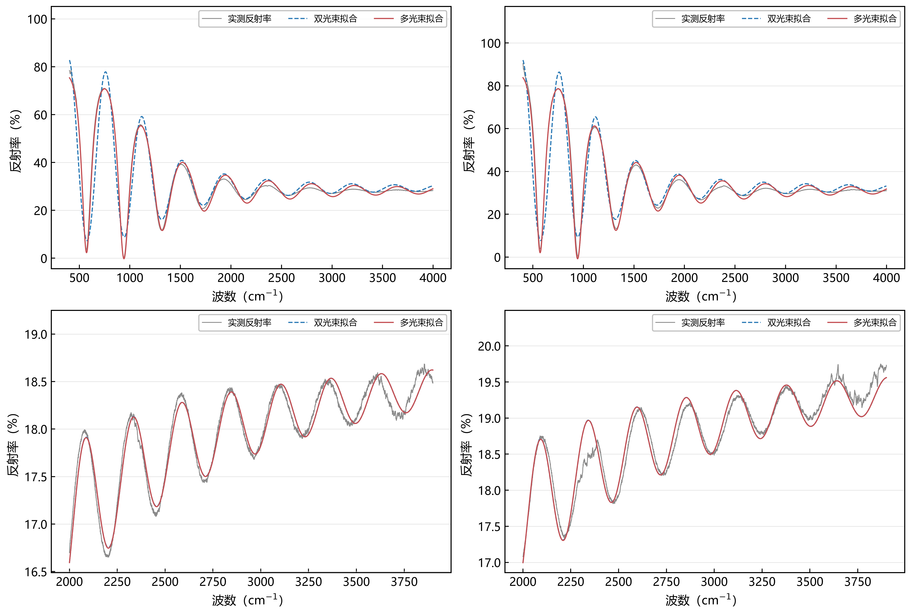

<div align="center">

# 🏆 全国大学生数学建模竞赛（CUMCM）· 省级三等奖

**五年国赛实战沉淀：完整的建模思路、Python 求解代码与结果图表**


[](https://github.com/sekai-lyr/cumcm-math-modeling/stargazers)

</div>

---

## 📖 项目简介

本仓库开源了我在**全国大学生数学建模竞赛（CUMCM）**中的全部参赛工作，其中 **2026 年 A 题「药材的烘干问题」获得省级三等奖**。

每个年份的文件夹对应一年完整参赛记录，包含：**赛题数据、按问题拆分的求解代码、结果图表与结果表格**。从波浪能装置的动力学模拟，到定日镜场的蒙特卡洛仿真，再到药材烘干的热质传递建模——可以完整看到一支队伍在国赛中的方法论演进。

> ⚠️ 最终提交论文涉及个人信息与评审要求，暂不公开；本仓库开源**思路、代码与全部可复现结果**。

## 📸 成果展示

**2026.A 药材烘干 —— 插值重建与误差分析（省三获奖作品）**

| 温度场插值对比 | 误差分析 |
|:---:|:---:|
|  |  |
| **水分浓度插值对比** | **温度场重建热图** |
|  |  |

**2024.A 板凳龙 —— 螺线轨迹与队形模拟**

| 螺线轨迹与刚性链结构 | 盘入过程关键时刻队形 |
|:---:|:---:|
|  |  |

**2025.B 光谱反演 —— 双光束与多光束拟合对比**



## 🗓️ 历年赛题一览

| 年份 · 赛题 | 研究内容 | 核心方法 | 代码入口 |
|---|---|---|---|
| 🏆 **2026.A** 药材的烘干问题 | 药材干燥过程数据重建与热质传递建模 | 数据插值、误差分析、干燥动力学 | [`2026.A/代码`](2026.A/代码) |
| 2025.B 光谱拟合与厚度反演 | 基于多光束干涉的光谱建模与薄膜厚度反演 | 非线性拟合、FFT 诊断、显著性分析 | [`2025.B/代码`](2025.B/代码) |
| 2024.A 板凳龙闹元宵 | 螺线盘入轨迹、位置优化与碰撞检测 | 数值积分、几何计算、分离轴判定 | [`2024.A/代码`](2024.A/代码) |
| 2023.A 定日镜场的优化设计 | 塔式太阳能镜场全年输出功率仿真与优化 | 蒙特卡洛模拟、交叉验证、参数分析 | [`2023.A/代码`](2023.A/代码) |
| 2022.A 波浪能最大输出功率设计 | 浮子受迫振荡与阻尼系数优化 | 常微分方程数值解、线性/非线性阻尼 | [`2022.A/代码`](2022.A/代码) |

## 📂 仓库结构

```text
全国数学建模比赛/
├── 2026.A/              # 🏆 省三获奖作品
│   ├── data/            #   赛题附件与结果数据
│   ├── 代码/            #   问题 1/3/4 求解代码
│   ├── 结果/            #   各问题结果表格
│   └── outputs/         #   插值对比与误差分析图
├── 2025.B/
│   ├── data/            #   题目 PDF 与附件
│   ├── 代码/            #   问题 2/3 求解代码
│   ├── 结果图像/        #   拟合对比与反演图
│   └── 结果表格/
├── 2022.A ~ 2024.A/     # 结构同上：data / 代码 / 结果图像 / 结果表格
└── README.md
```

> `参考文献/`（第三方版权论文）与团队内部文档未纳入版本管理，见 `.gitignore`。

## 🚀 复现说明

```bash
# 环境要求：Python 3.8+
pip install numpy pandas matplotlib scipy openpyxl

# 示例：运行 2026.A 问题一（插值重建）
python 2026.A/代码/问题1代码.py
```

各题目代码相互独立，按年份文件夹进入后直接运行对应 `问题N代码.py` 即可；数据附件已包含在各年 `data/` 目录。

## 🛠️ 技术栈

`数据处理` NumPy / Pandas / openpyxl · `科学计算` SciPy · `可视化` Matplotlib（PNG/SVG 双输出）· `验证方法` 误差分析 / 收敛性检验 / 交叉验证 / 物理一致性校核

---

<div align="center">

**如果这份建模资料对你备赛有帮助，欢迎点一个 ⭐ Star 支持一下！**

*Made with ❤️ by [sekai-lyr](https://github.com/sekai-lyr) · 更多项目见 [sekai-product](https://github.com/sekai-lyr/sekai-product)*

</div>
